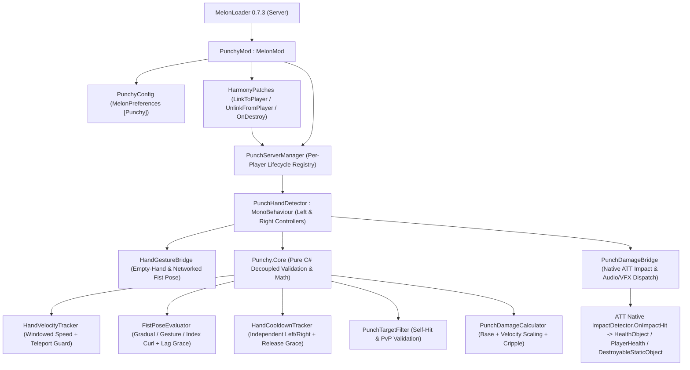

# Punchy — Architecture & Verified A Township Tale API Reference

All A Township Tale (ATT) runtime details, class names, namespaces, fields, properties, events, enum values, Harmony targets, and IL behaviors documented below were verified directly against the installed game binaries:
- `A Township Tale_Data/Managed/Root.Township.dll` (main game assembly; no `Assembly-CSharp.dll` exists)
- `A Township Tale_Data/Managed/Township.Core.Runtime.dll` (`Alta.Core.Settings.Settings`)
- `MelonLoader/Latest.log` (MelonLoader `v0.7.3 Open-Beta`, Unity `2020.3.23f1`, Game Version `main-1.7.2.1.42203`)
- `MelonLoader/GameObjectDump.txt` (in-game hierarchy dump of `VR Player Character New(Clone)` and world entities)

Nothing in this document is guessed or invented; private fields accessed via Harmony `AccessTools` are explicitly marked as private along with their verified declaring type.

---

## 1. Runtime & Scripting Backend

| Component | Verified Value | Source |
|---|---|---|
| Scripting Backend | **Mono** (`MonoBleedingEdge/`, x64, `A Township Tale_Data/Managed/*.dll` present, no `GameAssembly.dll`) | Install directory & `MelonLoader/Latest.log` |
| MelonLoader Version | `v0.7.3 Open-Beta`, `Runtime Type: net35` | `MelonLoader/Latest.log` |
| Unity Version | `2020.3.23f1` | `MelonLoader/Latest.log` |
| Game Identity | `[assembly: MelonGame("Alta", "A Township Tale")]` | `MelonLoader/Latest.log` |
| Main Game Assembly | `Root.Township.dll` (alongside `Township.Core.Runtime.dll`, `Alta.*.dll`) | `A Township Tale_Data/Managed/` |
| Mod Target Framework | `.NET Framework 4.7.2` (`net472`), referencing `MelonLoader/net35/MelonLoader.dll` & `0Harmony.dll` | Installed ATT MelonLoader mods |

**IL2CPP Compatibility Note:** Because ATT PCVR runs on **Mono** (not IL2CPP), custom `UnityEngine.MonoBehaviour` subclasses such as `PunchHandDetector` work natively without `ClassInjector.RegisterTypeInIl2Cpp<T>()`. As a defensive safeguard, `PunchyMod.OnInitializeMelon()` checks for `GameAssembly.dll` inside `MelonEnvironment.GameRootDirectory`; if ever launched under an IL2CPP build, it logs a clear error and disables itself cleanly instead of crashing.

---

## 2. Architecture Overview

- **`Punchy.Core`** (`netstandard2.0`): Pure C# library with zero Unity or MelonLoader dependencies (uses `Punchy.Core.Vec3`). Compiled directly into `Punchy.dll` (single-file deployment) and referenced directly by `Punchy.Tests` (`net8.0`).
- **Pure Server-Side Execution**: Every punch check, velocity sample, cooldown timer, self-hit exclusion, and damage dispatch is gated on `NetworkSceneManager.IsServer`. Remote clients require **zero mods**.

---

## 3. Verified Server Authority, Player Rig & Lifecycle APIs

### 3.1 Server Authority & Headless Detection

| Purpose | Verified Symbol | Namespace / Assembly | Notes |
|---|---|---|---|
| Authoritative server check | `NetworkSceneManager.IsServer` (`public static bool`) | Global (`Root.Township.dll`) | `true` on dedicated server and listen-server host; `false` on remote clients |
| Dedicated headless check | `ApplicationManager.IsHeadless` (`public static bool`) | Global (`Root.Township.dll`) | Checks `-batchmode` or `-nographics` CLI args; guards audio/particle playback |
| Server config singleton | `Alta.Networking.Servers.ServerHandler.Current` (`public static ServerHandler`) | `Alta.Networking.Servers` (`Root.Township.dll`) | `.ServerConfig.Settings` -> `Alta.Utilities.ServerSettings` |

### 3.2 Player & Player Rig Classes

| Class / Member | Type / Signature | Verified Details |
|---|---|---|
| `Player` | `Player : Alta.Networking.NetworkEntity` (global) | `AllPlayers` (`HashSet<Alta.Networking.Scripts.Player.IPlayer>`), `OnPlayerAdded` (`Action<Player>`), `OnPlayerRemoved` (`Action<Player>`), `PlayerController`, `UserInfo` |
| `PlayerController` | `PlayerController : Alta.Networking.NetworkEntityBehaviour` (global) | Base rig controller for networked players |
| `Alta.Character.PlayerCharacter` | `: SmoothLocomotionPlayerController : VRPlayerController : PlayerController` | Gameplay avatar type (`VR Player Character New(Clone)`). Distinguishes real gameplay avatars from `MainMenuPlayerController`, `CustomizationPlayerController`, `FlyCamPlayer` |
| `PlayerController.LeftController` / `RightController` | `public Controller` | Hand controller components attached to `<id> - Left Hand` / `<id> - Right Hand` |
| `PlayerController.Health` | `public HealthObject` | Runtime instance is `PlayerHealth : HealthObject`, located on sibling child `<id> - Health` (NOT parent of body hitboxes) |
| `PlayerController.NetworkPlayer` | `public Player` | Associated `Player` entity |
| `NetworkEntityBehaviour.Entity` | `public Alta.Networking.NetworkEntity` | Inherited by `PlayerController`; used as `ImpactHit.Wielder` and `OnCausedCombat` |
| `PlayerController.IsAlive`, `IsDowned`, `IsSpirit`, `IsIgnoringDamage` | `public bool` | Server-authoritative player life state |
| `PlayerController.OnCausedCombat` | `public void OnCausedCombat(NetworkEntity attackee, float distanceBetweenCombatantsSquared, float damage)` | Fires `PlayerController.CausedCombat` for combat-state listeners |

### 3.3 Hand Controller & Held-Item State

Located on `<id> - Left Hand` and `<id> - Right Hand` (`GameObjectDump.txt` L229264, L229393):
- `Controller` (`global`)
- `Alta.Character.Hand`
- `Alta.Networking.NetworkEntity`
- `Alta.Networking.NetworkTransform` — Drives `Controller.transform` on the server from remote client transform packets (`EntitySerializer` -> `NetworkTransform.Serialize` -> `Snap`), and `PlayerInput.TargetTransform` drives it on local/host players. Because `Controller.transform.position` updates authoritatively on both headless dedicated servers and listen-server hosts, attaching `PunchHandDetector` directly to `LeftController.gameObject` and `RightController.gameObject` tracks every player's true hand world-space position.
- `HandGestureController` & `HandCollisionsController` — Present on `<id> - Left Hand` / `<id> - Right Hand`. (Note: `Alta.Networking.ClientOnly` disables specific client-only behaviours in its array on non-local servers, while `Controller`, `Alta.Character.Hand`, `NetworkTransform`, and `HandGestureController`'s `INetworkSerialized` serialization continue operating).

**Verified Empty-Hand Check APIs:**
- `Controller.Interactor` (`public Interactor`) -> `Interactor.IsInteracting` (`public bool`: `interactingWith != null`) and `Interactor.InteractingWith` (`public Interactable`).
- `Controller.TryGetHeldPickup(out Pickup pickup)` (`public bool`): checks `Interactor.IsInteracting && (Interactor.InteractingWith is Pickup)`.
- Checking `Interactor.IsInteracting || Interactor.InteractingWith != null || TryGetHeldPickup(out _)` ensures **any** held weapon, tool, torch, pouch, or grabbed world object (climbing, handles, levers) blocks bare-handed punching so weapons never deal double damage.
- `Controller.TriggerHaptic(float strength, float duration, float frequency)` (`public void`): used for subtle local host feedback when `attacker.IsLocalPlayer`.

---

## 4. Phase 1 Investigation: Networked Hand Pose & Finger Curl Replication

A key engineering question is whether remote clients' hand-grip / finger-curl states are replicated to the server in ATT's network protocol.

**Verified Finding (from IL inspection of `HandGestureController` & `Alta.Networking.EntitySerializer`):**
**YES — ATT replicates hand pose & grip/finger-curl state from clients to the server.**

Specifically:
1. `HandGestureController : ControllerExtension` implements `Alta.Networking.INetworkSerialized` and `Alta.Networking.INetworkEntityBehaviour`.
2. `NetworkEntity.CreateSerializer` registers all `INetworkSerialized` components on the hand entity into `EntitySerializer`. Every incoming network state update invokes `EntitySerializer.ReadFromStreamInternal` -> `INetworkSerialized.Serialize(Stream stream, bool isWriteFull)` regardless of whether `ClientOnly` disabled `HandGestureController.Update()` visuals or whether the process is headless.
3. Inside `HandGestureController.INetworkSerialized.Serialize(Stream, bool)`, ATT serializes three modes:
   - **Explicit Gesture (`private HandGestureDefinition currentGesture` & `private GestureMap gestureMap`)**:
     - Serialized as `currentGesture.AnimatorTransitionIndex` (`[-1, 15]`) and looked up via `HandGestureDefinition.GestureForAnimationIndex`.
     - `HandGestureDefinition.ActiveFingers` (`public HandFingers`) is a `[Flags]`-style bitmask (`Thumb = 1`, `IndexFinger = 2`, `MiddleFinger = 4`, `RingFinger = 8`, `LittleFinger = 16`) verified in `HandCollisionsController.EnabledCollidersForGesture` to enable fingertip colliders for **extended** fingers. Therefore `ActiveFingers == 0` represents a **closed fist**.
     - `gestureMap.IdleGesture` distinguishes explicit gestures (pointing, thumbs-up, fist gesture) from idle/gradual grip.
   - **Free Gesture / Valve Index Skeletal Finger Tracking (`private bool isFreeGestureMode` & `private float[] skeletonInput`)**:
     - When `isFreeGestureMode == true`, ATT serializes 5 floats (`skeletonInput[0..4]`, `[0..1]`, 5 bits each).
     - Verified via `SteamVRInputController.PopulateInput` (`sum > 2.5f` triggers `Grab`) and `HandCollisionsController.EnableCollidersForFreeMode` (`axis < idleCollidersThreshold`): **higher values represent curled fingers (`0` = open, `1` = curled)**.
     - Fist rule: average of all 5 curls `>= 0.65f` **and** at least 3 of the 4 non-thumb fingers (indices `1..4`) `>= 0.50f` (preventing false positives when pointing with 3 curled fingers or open-palm waving).
   - **Standard Gradual Grip (`private float gripAxis`, OpenXR / Quest / SteamVR squeeze)**:
     - When `isFreeGestureMode == false` and `currentGesture == gestureMap.IdleGesture`, ATT quantizes `gripAxis` (`[0..1]`, driven by `OpenXRWrapper.OnSqueeze` / `SteamVRInputController.squeezeAction`) into 32 steps (`0.03125`, `GripNetworkingBits = 5`) and serializes it to the server.
     - Fist rule: `gripAxis >= 0.70f` (configurable internal threshold matching firm controller grip/fist).

**Private Fields Read Safely via Cached Harmony `AccessTools.FieldRefAccess` (`HandGestureBridge`):**
- `HandGestureController.currentGesture` (`private HandGestureDefinition`)
- `HandGestureController.gestureMap` (`private GestureMap`)
- `HandGestureController.gripAxis` (`private float`)
- `HandGestureController.isFreeGestureMode` (`private bool`)
- `HandGestureController.skeletonInput` (`private float[]`)

**Network Pose Lag & Graceful Fallback Handling:**
- **Pose-Lag Grace Window (`0.12s`)**: `HandGestureController` serializes `gripAxis` in quantized `0.03125` increments over network packets that can slightly trail fast `NetworkTransform` motion spikes. `FistPoseEvaluator.EvaluateWithLagGrace` remembers the last closed-fist timestamp (`lastClosedFistTime`) and allows a brief `0.12s` grace window during rapid follow-through, provided the player is not holding an item.
- **Graceful Fallback**: If a hand rig lacks `HandGestureController`, if private reflection resolution ever returns null, or if `RequireClosedFist = false`, `HandGestureBridge` returns `HasGestureData = false`, and `FistPoseEvaluator` cleanly falls back to **empty-hand + velocity + trajectory validation** (`StepDistance > 0.001m` and `Speed >= MinPunchSpeed`) without throwing or blocking punches.

---

## 5. Verified Native Damage, PvP, Armor & Impact Pipeline

### 5.1 Damage Hierarchy & Call Flow

| Type | Namespace | Verified Role |
|---|---|---|
| `ImpactType` | `Alta.Impact` | Enum: `Pierce = 0, Slash = 1, Blunt = 2, Caustic = 3, Poison = 4, Explosive = 5, Spiritual = 6`. Bare-handed punches use `ImpactType.Blunt` (`2`). |
| `DamageSource` | `Alta.Impact` | Enum: `FallDamage = 0, Impact = 1, Command = 2, AreaOfEffect = 3, Poison = 4, Hunger = 5, Unknown = 6, Fire = 7`. `ImpactHit` constructor sets `DamageSource.Impact` (`1`). |
| `ImpactHit` | `Alta.Impact` | `: DamageData`. Constructor: `public ImpactHit(float baseHealthDamage, float baseCrippleDamage, float multipliers, float effectiveness, ImpactDetector detector, ImpactType impactType, Vector3 point, Vector3 normal, Vector3 direction, Collider struckCollider, NetworkEntity wielder, PlayerController playerWielder)` |
| `ImpactDetector` | `Alta.Impact` | Attached to non-trigger body colliders on players, creatures (Spriggulls, Goteras, Turabadas, Wyrms), and breakables. Links to `HealthTarget` (`HealthObject`) and optionally `DestroyableStaticObject`. |
| `HealthObject` | Global | Base health component. `Awake()` sets `detector.HealthTarget = this`; `OnEnable()` subscribes `DetectImpact(ImpactHit)` to `ImpactDetector.Hit`. |
| `PlayerHealth` | Global | `: HealthObject`. Sits on `<id> - Health`. Overrides `ReceiveDamage(...)` and `HandleObjectReachedZeroHealth()` (`OnDowned()`). |
| `Alta.Networking.DestroyableStaticObject` | `Alta.Networking` | Breakable world objects (crates/pots/static destructibles) subscribing to `ImpactDetector.Hit` -> `Hit(ImpactHit)`. |

### 5.2 Exact IL Math Inside Native Damage Execution

1. `ImpactHit.get_HealthDamage()`:
   $$\text{HealthDamage} = \text{IsValid} \ ? \ (\text{BaseHealthDamage} \times \text{Effectiveness} \times \text{DamageMultiplier} \times \text{Multipliers} \times \text{HealthMultiplier}) : 0$$
   where `IsValid` is `Effectiveness > 0f`, and `DamageMultiplier` reads `ServerHandler.Current.ServerConfig.Settings.DamageX` on the server.
2. `HealthObject.DetectImpact(ImpactHit)`:
   - Applies per-`ImpactType` multipliers (`HealthObject.impactTypeMultipliers[Blunt]`) and armor mitigation (`ImpactDetector.CurrentArmor.GetMultiplier(Blunt)`).
   - Calls virtual `ReceiveDamage(HealthDamage * armorAndTypeMult, CrippleDamage * armorAndTypeMult, impact)`.
   - Clears `LastHit = null` on server **after** `ReceiveDamage`, then invokes `HealthObject.OnHit`.
3. Inside `HealthObject.ReceiveDamage`:
   - Guards `NetworkSceneManager.IsServer`.
   - Sets `LastHit = impact` and `healthStat.ChangeData = impact`, then subtracts damage from `healthStat.Base` and cripple damage from `crippleStat.Base`.
   - Stat changes propagate via `StatManager` to `HealthObject.StatChanged`:
     - Triggers `HealthObject.HealthChanged` -> `Alta.Intelligence.Agent.HealthChanged` (adds attacker `Wielder`'s `ITargetPointer` to `Agent.Hurt` & `GeneralActionDecider.AddTarget`, making creatures aggro and react naturally) and `PlayerHealth.CheckForDamage` (`recentDamageStat`).
     - Replicates health updates to clients; on the damaged local client `PlayerHealth.UpdateVisuals` plays `HurtVignette` (red damage hit flash).
     - When health reaches `<= 0f`, `HandleObjectReachedZeroHealth()` runs:
       - On non-player `HealthObject`s: `OnKilled()` constructs `ObjectKilledData` -> `KilledData(LastHit)` using `ImpactHit.Wielder` / `ImpactHit.PlayerWielder` for death attribution and sends `syncDeath` RPC.
       - On `PlayerHealth`: `OnDowned()` invokes `Downed(LastHit)` so native downed/spirit/death/drop-on-death rules execute with `LastHit.PlayerWielder` attributed!

### 5.3 Verified `ImpactHitWithTool` Null-Tool Crash & PvP Handling

IL inspection of `HealthObject.ReceiveDamage` and `PlayerHealth.ReceiveDamage` revealed two critical invariants:
1. **`ImpactHitWithTool` with `Tool == null` crashes**:
   - `HealthObject.ReceiveDamage` IL checks `if (isCombatant && (impact as ImpactHitWithTool)?.Tool.PlayerWielder != null)` without null-checking `.Tool` after `isinst ImpactHitWithTool` succeeds (`IL_0025: call get_Tool()` -> `IL_002A: callvirt get_PlayerWielder()`).
   - `ImpactDetector.OnToolHit` indexes `Dictionary<ImpactTool, float> hitCooldowns` by `impactWithTool.Tool`.
   - Therefore, Punchy **must NOT** construct `ImpactHitWithTool` with a null `Tool`. Instead, just like ATT's native non-weapon attacks (`Explosive.Trigger`, `AreaAttackSkill.DealDamage`, `SeedSpray.SyncBasicImpact`), Punchy constructs a native **`ImpactHit`** with `ImpactType.Blunt`, `Wielder = attacker.Entity`, and `PlayerWielder = attacker`.
2. **Native Server PvP Rules (`PlayerHealth.ReceiveDamage` IL_007A–00D4)**:
   - Because `PlayerHealth.ReceiveDamage` only checks `ServerSettings.IsPVPEnabled`, `PVPMultiplier`, and `PVPCrippleMultiplier` when `impact is ImpactHitWithTool`, Punchy explicitly reads `ServerHandler.Current?.ServerConfig?.Settings`:
     - Rejects `PlayerHealth` hits whenever `!AllowPvPPunching` (mod config) **or** `!ServerSettings.IsPVPEnabled` (server config).
     - Applies `ServerSettings.PVPMultiplier` to `hit.HealthMultiplier` and `ServerSettings.PVPCrippleMultiplier` to `hit.CripplingMultiplier` on `PlayerHealth` targets so server PvP scaling behaves identically to weapon hits.
   - Because `HealthObject.ReceiveDamage` only calls `MarkAssailant` for `ImpactHitWithTool`, `PunchDamageBridge` also calls `attacker.OnCausedCombat(...)` when `health.IsCombatant` is true.

---

## 6. Native Audio, VFX & Multiplayer Feedback Boundaries

| Effect | Native ATT Mechanism | Headless vs Listen Server / Client Replication |
|---|---|---|
| **Native Orange Creature/Prop Hit VFX & Sound (Replicated to Unmodded Clients)** | `NativeImpactSyncBridge.BroadcastNativeImpactEffects` sends `ImpactDetector.ImpactSyncArguments` via `ImpactDetectorCentral.SendArguments` (or `ImpactDetector.syncImpact.SendToChunks`) referencing an unheld, chunk-spawned proxy `ImpactTool` | **Replicated to all unmodded clients in the chunk** even from headless dedicated servers! Clients run `GenerateImpactOnDetector(...).Hit()` -> `OnToolHit` -> `ImpactDetectorSettings.PlayEffects(hit)` (spawning the exact native orange Spriggull hit effect and playing the native impact sound). `HealthObject.ReceiveDamage` and `DurabilityModule.AffectDurability` both no-op on non-servers (`zero duplicate damage`, `zero durability loss`), and `PlayerWielder == null` avoids client-to-server echo. Skipped for `PlayerHealth` targets because `ImpactDetector.SyncImpact` rejects `PlayerHealth` when `fromPlayer` differs. |
| **Layered Kinetic VFX** | `PunchVfxSystem` (pooled 3-layer procedural `ParticleSystem` rig: shockwave ring + stretched sparks + impact dust puff scaled by `PunchVfxCalculator`) | Runs in non-headless server/host builds alongside `ImpactDetector.OnImpactHit` (`ImpactDetectorSettings.PlayEffects`) and `PickupTypeSettings.DefaultBreakEffect` fallback; skipped on headless servers (`ApplicationManager.IsHeadless`). |
| **Local Host Blunt Impact SFX** | `AudioManager.Instance.PlaySoundEffectAt(SoundEffectExtensions.Resolve(SoundEffect.FistBump, targetGo), hitPoint, targetGo)` (value `51`; fallbacks `WoodThump = 71`, `ShieldBashWood = 29`) | Plays locally on non-headless builds / listen hosts. Remote clients hear the native target impact sound replicated via `NativeImpactSyncBridge` above. |
| **Client-Visible Replicated Feedback (Zero Client Mods)** | Native `StatManager` (health/cripple), `PlayerHealth.UpdateVisuals` (`HurtVignette` flash), `HealthObject.syncDeath` + `KilledData`, `Agent` AI aggro + `NetworkAnimator`, `NetworkRigidbody` impulse, `ModifiableStaticManager` prop break | **100% replicated to unmodded vanilla clients** automatically through ATT's native sync pipeline! |
| **Attacker Local Host Haptics** | `Controller.TriggerHaptic(0.6f, 0.08f, 120f)` | Fires if `attacker.IsLocalPlayer`. |

---

## 7. Verified Harmony Patch Targets & Lifecycle Strategy

All Harmony patches target `PlayerController` (global namespace, `Root.Township.dll`):

| Target Method | Patch Kind | Signature | Purpose |
|---|---|---|---|
| `PlayerController.LinkToPlayer(Player networkPlayer, PlayerInput left, PlayerInput right)` | **Postfix** | `public void LinkToPlayer(Player, PlayerInput, PlayerInput)` | Registers `PlayerCharacter` hands on server (`PunchServerManager.RegisterPlayer(__instance)`) after `LeftController` & `RightController` are initialized |
| `PlayerController.UnlinkFromPlayer()` | **Prefix** | `public void UnlinkFromPlayer()` | Immediately unregisters hand detectors when a player unlinks/despawns/respawns |
| `PlayerController.OnDestroy()` | **Prefix** | `protected void OnDestroy()` | Defensive cleanup guard if a controller is destroyed without `UnlinkFromPlayer` |

Additional lifecycle safety nets:
- `Player.OnPlayerRemoved += OnPlayerRemoved` cleans up any tracked controller associated with a disconnecting `Player`.
- `PunchyMod.OnUpdate()` invokes `PunchServerManager.ReconcileConnectedPlayers()` every `2.0s` on server to prune destroyed `PlayerController` keys and catch any active `PlayerCharacter` in `Player.AllPlayers` not yet registered (e.g., hot-reload or edge-case spawn sequences).
- `PunchyMod.OnSceneWasUnloaded()` and `OnDeinitializeMelon()` destroy all active `PunchHandDetector` components and clear the registry cleanly.

---

## 8. Configuration (`UserData/MelonPreferences.cfg`, `[Punchy]`)

| Key | Type | Default | Description |
|---|---|---|---|
| `Enabled` | `bool` | `true` | Master toggle for bare-handed punching |
| `BasePunchDamage` | `float` | `0.1` | Base damage at `MinPunchSpeed` (20 punches = `2.0` default player HP) |
| `MaxPunchDamage` | `float` | `0.15` | Maximum scaled damage at fast swing speed (`6.0 m/s`) |
| `EnableVelocityScaling` | `bool` | `true` | Scales damage from `BasePunchDamage` to `MaxPunchDamage` by hand speed |
| `MinPunchSpeed` | `float` | `2.2` | Minimum world-space hand speed (`m/s`) to register a punch |
| `PunchCooldownSeconds` | `float` | `0.4` | Per-hand cooldown (`s`) between registered hits |
| `RequireClosedFist` | `bool` | `true` | Requires closed fist from networked gesture/grip/curl state (falls back gracefully if unavailable) |
| `AllowPvPPunching` | `bool` | `true` | Allows punching other players (still obeys native `ServerSettings.IsPVPEnabled`) |
| `EnablePunchVfx` | `bool` | `true` | Enables pooled 3-layer shockwave/spark/dust punch impact VFX (non-headless builds) |
| `PunchVfxScale` | `float` | `1.0` | Uniform scale multiplier (`0.1` to `3.0`) for punch impact VFX |
| `EnableSurfaceImpactVfx` | `bool` | `true` | Enables subtle punch VFX + blunt thud SFX when punching solid non-damageable world surfaces |
| `DebugLogging` | `bool` | `false` | Enables throttled punch hit/rejection console logs |
| `EnableRagdoll` | `bool` | `true` | Master toggle for optional `RagdollLib` punch ragdolls |
| `RagdollPlayersOnHaymaker` | `bool` | `true` | Enables haymaker ragdolls on `PlayerCharacter` rigs (also requires `[RagdollLib] AllowPlayerRagdoll = true`) |
| `PlayerRagdollMinSpeed` | `float` | `5.0` | Minimum haymaker hand speed (`m/s`) to ragdoll a player |
| `PlayerRagdollBaseImpulse` | `float` | `105.0` | Base player knockdown impulse (`N*s`, clamped `5..350`) |
| `PlayerRagdollMaxImpulse` | `float` | `160.0` | Maximum player knockdown impulse (`N*s`, clamped `<= 350`) |
| `PlayerRagdollDuration` | `float` | `2.8` | Player ragdoll recovery duration (`s`) |
| `RagdollSmallCreatures` | `bool` | `true` | Enables punch ragdolls on small creatures (`Spriggull`, `Babu`, `Schmeechee`, `FireBug`, `Dragonfly`, `Wyrm`) |
| `SmallCreatureRagdollMinSpeed` | `float` | `2.2` | Minimum punch speed (`m/s`) to ragdoll small creatures |
| `SmallCreatureRagdollBaseImpulse` | `float` | `85.0` | Base impulse (`N*s`) for normal punches on small creatures |
| `SmallCreatureRagdollMaxImpulse` | `float` | `135.0` | Maximum impulse (`N*s`) on small creatures |
| `SmallCreatureRagdollDuration` | `float` | `2.6` | Small creature ragdoll recovery duration (`s`) |
| `RagdollLargeCreatures` | `bool` | `true` | Enables haymaker ragdolls on large creatures (`Gotera`, `GreaterGotera`, `Turabada`, `Phantom`) |
| `LargeCreatureRagdollMinSpeed` | `float` | `5.5` | Minimum haymaker speed (`m/s`) to ragdoll large creatures |
| `LargeCreatureRagdollBaseImpulse` | `float` | `120.0` | Base impulse (`N*s`) on large-creature haymakers |
| `LargeCreatureRagdollMaxImpulse` | `float` | `180.0` | Maximum impulse (`N*s`) on large creatures |
| `LargeCreatureRagdollDuration` | `float` | `2.5` | Large creature ragdoll recovery duration (`s`) |
| `RagdollUpwardBoost` | `float` | `0.22` | Grounded upward lift ratio (`0.0` to `0.50`) |

---

## 9. Optional `RagdollLib` Integration (v1.2.2+)

- **Soft Dependency & Client/Server Simulation:** `PunchyMod` declares `[assembly: MelonOptionalDependencies("RagdollLib")]`, `Punchy.csproj` references `Mods\RagdollLib.dll` with `<Private>false</Private>`, and all references to `RagdollLib.API.RagdollAPI` are isolated inside `[MethodImpl(MethodImplOptions.NoInlining)]` calls in `PunchRagdollBridge`.
  - When `NetworkSceneManager.IsServer` is `true`, `Punchy` runs full combat authority (damage, PvP, death attribution, native VFX sync) plus server-side `RagdollLib` simulation (AI stop + root tracking).
  - When `!NetworkSceneManager.IsServer` and `RagdollLib.dll` is present, `PunchHandDetector` runs **visual-only ragdoll detection** (`PunchRagdollBridge.TryApplyPunchRagdoll`, zero damage/health edits) so `RagdollController` suspends `NetworkRigidbody` & `Animator` locally and renders full-rig procedural ragdoll limbs instead of stiff root-only sliding.
- **Target Classification (`Alta.Intelligence.Agent` subclasses verified in `Root.Township.dll`):**
  - `Player`: `PlayerHealth` or `PlayerCharacter` ancestor -> requires heavy haymaker (`>= 5.0 m/s`, `105..160 N*s`, `2.8s`), plus `[RagdollLib] AllowPlayerRagdoll = true`.
  - `SmallCreature`: `Spriggull`, `Babu`, `Schmeechee`, `FireBug`, `Dragonfly`, `Wyrm` -> triggers on normal punch (`>= 2.2 m/s`, `85..135 N*s`, `2.6s`).
  - `LargeCreature`: `Gotera`, `GreaterGotera`, `Turabada`, `Phantom` (or any other `Agent` fallback) -> requires heavy haymaker (`>= 5.5 m/s`, `120..180 N*s`, `2.5s`).
  - Non-creature static props / training dummies (`combat_dummy(Clone)`) without `Agent` or `PlayerCharacter` return `None`.
- **Upper-Body Torque Targeting & Anti-Moon Shaping (`PunchRagdollBridge` + `PunchRagdollCalculator`):**
  - Resolves and passes `NetworkEntity.PrefabRoot.transform` directly into `RagdollAPI.TriggerRagdoll(...)`, blends horizontal punch direction (`60%`) with attacker-to-target away direction (`40%`), and lifts hit points below `root.y + 0.55m` to `root.y + 0.60m` (upper torso/chest) so `RagdollController.ApplyImpulse` creates visible limb/spine rotational tumble instead of stiff pelvis sliding.
  - Vertical component of the incoming punch direction is projected horizontally and capped (`<= 0.50`), and all impulse magnitudes are clamped (`<= 350 N*s` in `PunchConfigSnapshot.Sanitize()`).
  - When `RagdollAPI.TriggerRagdoll(...)` succeeds on a hit, `PunchDamageBridge` skips its fallback `Rigidbody.AddForceAtPosition` knockback so forces never double-stack.
